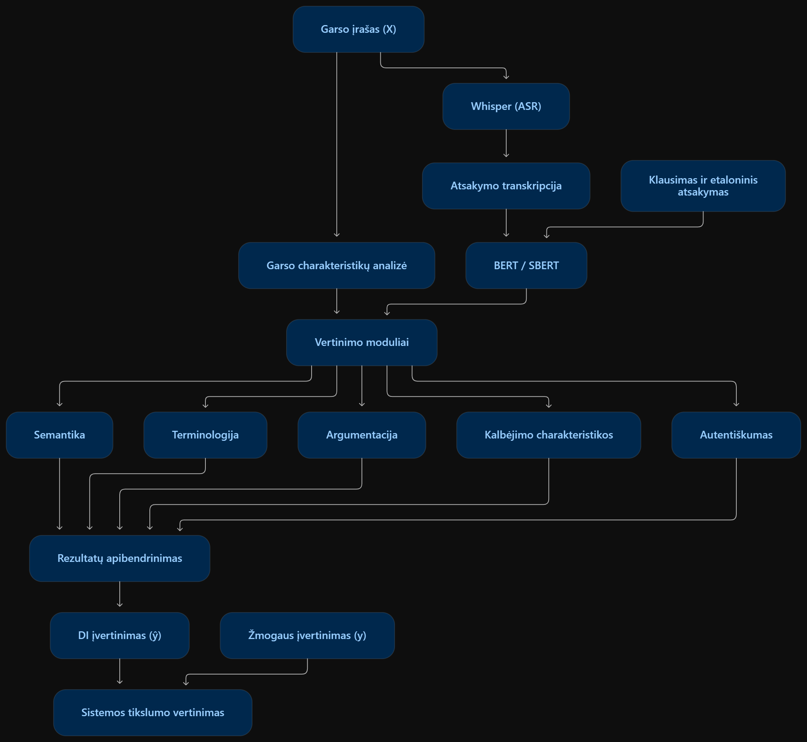

# 1.2 Duomenų rinkinio aprašymas

Magistrinio darbo tikslas – sukurti dirbtiniu intelektu
paremtą automatinio žodinių atsakymų vertinimo sistemą.

## Įvesties duomenys (X)

- Žodinis atsakymas (garso įrašas).
- Klausimas.
- Etaloninis atsakymas.

## Tikslinė reikšmė (y)

Žmogaus vertintojo suteiktas žodinio atsakymo įvertinimas.

## Duomenų (X, y) pavyzdžiai

| Garso failas | Klausimas | Etaloninis atsakymas | Žodinio atsakymo transkripcija | Įvertinimas (y) |
| --- | --- | --- | --- | --- |
| answer_01.wav | Kas yra RAM? | Laikinoji atmintis, kurios turinys prarandamas išjungus maitinimą. | RAM laikinai saugo duomenis. | 10 |
| answer_02.wav | Kas yra RAM? | Laikinoji atmintis, kurios turinys prarandamas išjungus maitinimą. | RAM saugo informaciją. | 5 |
| answer_03.wav | Kas yra RAM? | Laikinoji atmintis, kurios turinys prarandamas išjungus maitinimą. | RAM yra procesorius. | 1 |

Pateikti pavyzdžiai yra iliustraciniai ir demonstruoja
preliminarią įvesties duomenų bei tikslinių reikšmių struktūrą.

## Prognozuojamas rezultatas (y)

Dirbtinio intelekto sistema, atlikusi žodinio atsakymo
analizę, prognozuoja atsakymo įvertinimą (y).

Sistemos sugeneruotas įvertinimas gali būti palyginamas
su žmogaus vertintojo suteiktu įvertinimu (y), siekiant
nustatyti sistemos tikslumą.

  

# Projekto aprašymas kaip vientiso sprendimo (End-to-End)

Kuriama dirbtiniu intelektu paremta automatinio žodinių atsakymų vertinimo sistema apima visą duomenų apdorojimo procesą – nuo žodinio atsakymo garso įrašo pateikimo iki galutinio atsakymo įvertinimo ir grįžtamojo ryšio generavimo.

## Sistemos veikimo etapai

1. Įvesties duomenų surinkimas – pateikiamas žodinio atsakymo garso įrašas, klausimas ir etaloninis atsakymas.

2. Automatinis kalbos atpažinimas (ASR) – naudojant „Whisper“ modelį, garso įrašas konvertuojamas į tekstą.

3. Teksto reprezentacija – naudojant BERT arba SBERT modelį, tekstas paverčiamas skaitine reprezentacija.

4. Garso charakteristikų analizė – analizuojamas kalbėjimo tempas, pauzių dažnis, trukmė ir kitos kalbėjimo charakteristikos.

5. Automatinis atsakymo vertinimas pagal penkis kriterijus:
   - Semantika.
   - Terminologija.
   - Argumentacija.
   - Kalbėjimo charakteristikos.
   - Autentiškumas.

6. Vertinimo rezultatų apibendrinimas – sujungiami atskirų vertinimo kriterijų rezultatai.

7. Galutinio įvertinimo ir grįžtamojo ryšio pateikimas.

## Sistemos tikslumo vertinimas

Sistemos prognozuojami įvertinimai (ŷ) palyginami su žmogaus vertintojo suteiktais įvertinimais (y), siekiant nustatyti kuriamos sistemos tikslumą ir patikimumą.

  

# Preliminarus proceso modelis

